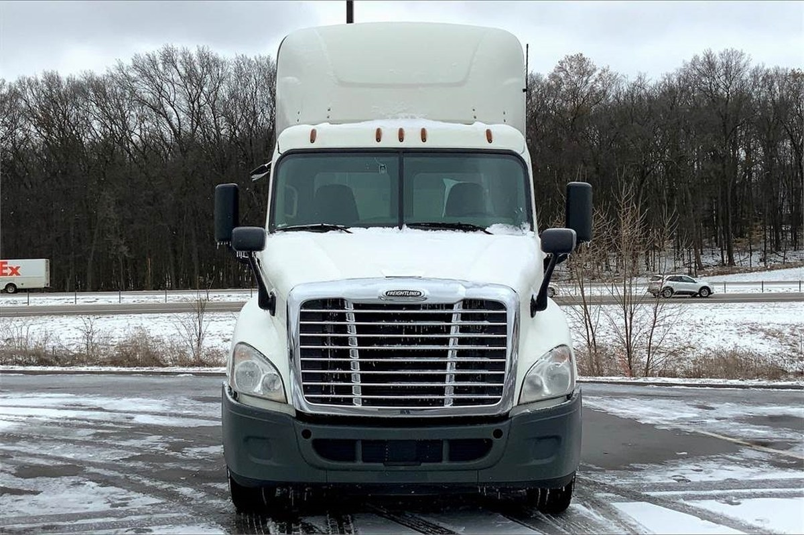
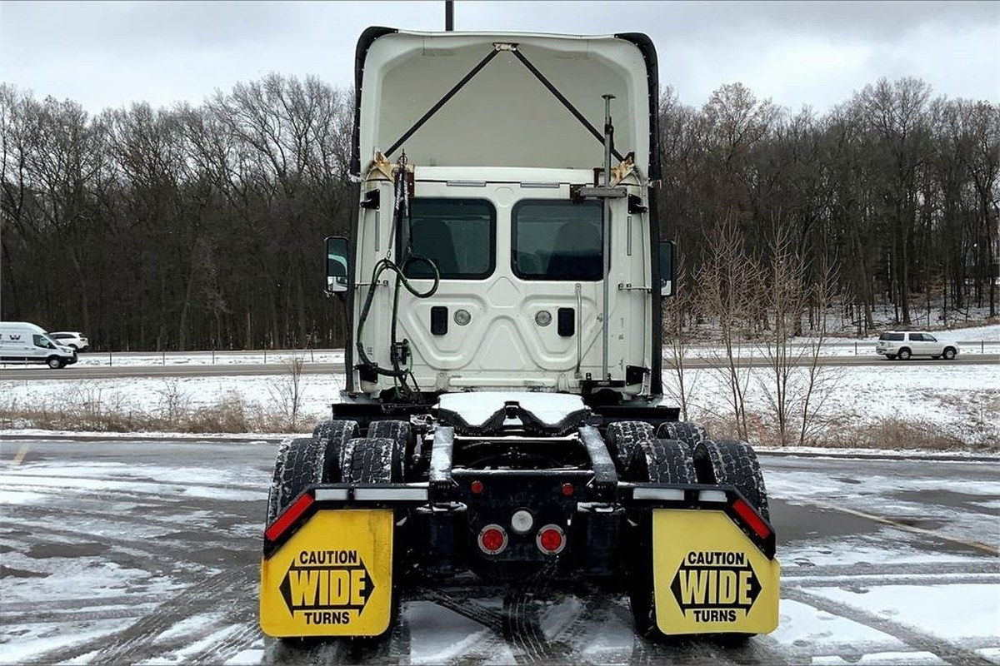
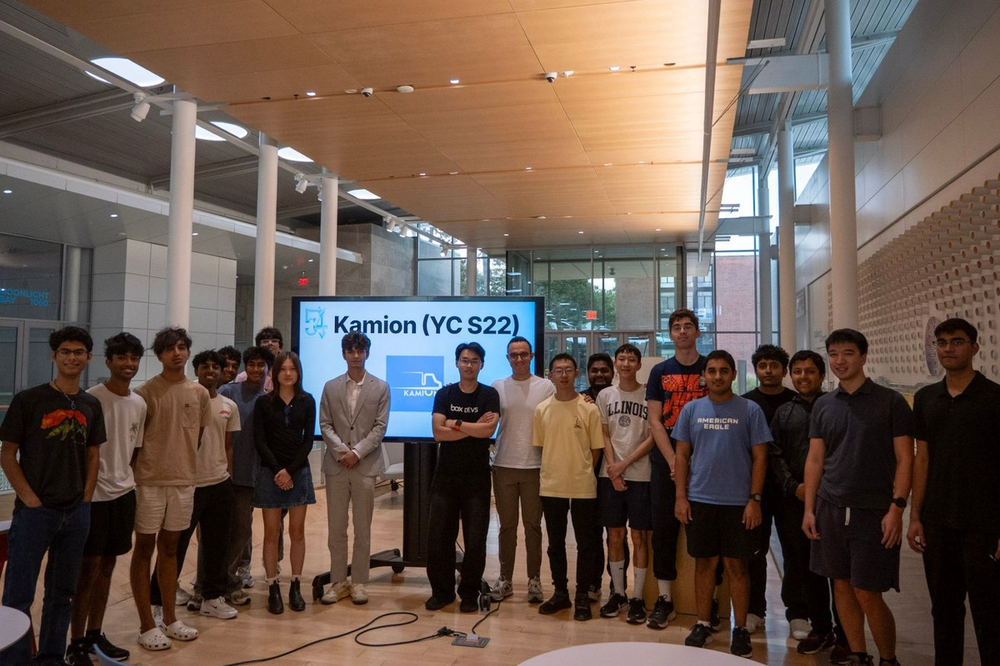
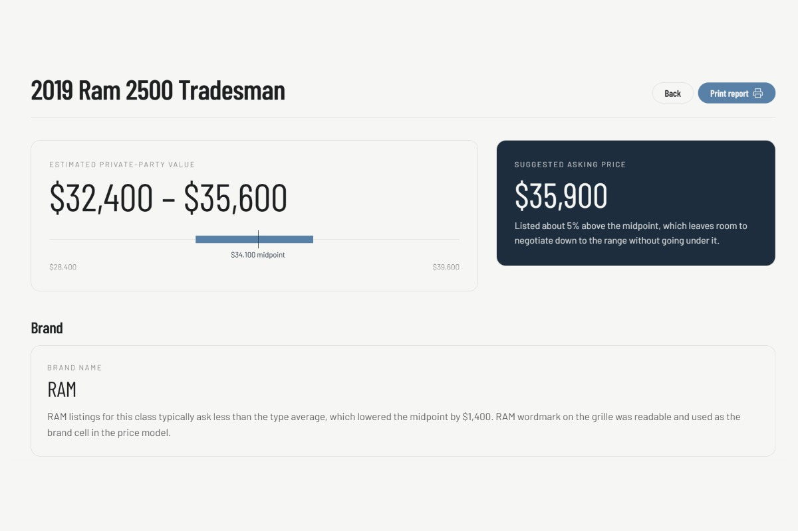
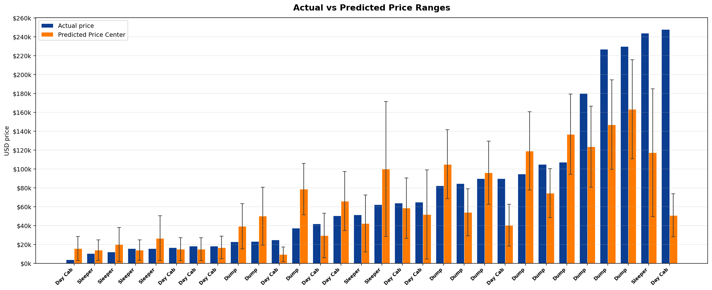

# Truck-Pricing-VLM

Kamion (YC S22) runs a marketplace where sellers set their own asking price for a truck they're trying to sell. However, sellers typically lie and overstate the price of their truck which misguides buyers. We built **truck Pricing VLM** which extracts a truck's condition, band and age using a Claude Sonnet 4.5 Vision Language Model. It transforms these quantities into a feature vector and run's a pricing algorithms to determine the price range of the truck. Truck-Pricing-VLM won **2nd Place at the UIUC Founders Hackathon (Kamion YC S22 Track)**.

- **Live App:** https://truck-pricing-vlm.vercel.app
- **Dataset:** https://huggingface.co/datasets/Raghavsk24/truckpaper_scraped_images_dataset

<table border="1">
  <tr>
    <td></td>
    <td></td>
  </tr>
  <tr>
    <td></td>
    <td></td>
  </tr>
</table>

## Tech Stack

<div align="center">

   

    

    

   

</div>

## System Overview

```
   Scrape TruckPaper listings (Class 7/8 positives, Class 2-6 negatives)
              │ 
              ▼
  ┌───────────────────────────────────────────────────────────────┐
  │  Offline pipeline  (Python)                                   │
  │    audit            ──► priced, USD-only, deduplicated images │
  │    filter eval      ──► truck_type accuracy vs. gold folders  │
  │    VLM labeling     ──► type, subject, brand, era, condition  │
  │    fit_price_range  ──► price_range_model.json + plot         │
  └───────────────────────────────────────────────────────────────┘
              │ model JSON + master schema copied to web/data
              ▼
  Seller's browser (Next.js on Vercel)
     upload photo │ POST /api/analyze          brand reply │ POST /api/price
              ▼                                           ▼
  ┌───────────────────────────────────────────────────────────────┐
  │  API routes  (Node.js)                                        │
  │    sharp resize     ──► 1568 px JPEG                          │
  │    Claude (vision)  ──► master-schema JSON features           │
  │    pricing.ts       ──► center, low, high, contributions      │
  └───────────────────────────────────────────────────────────────┘
        │ upload + insert                          │
        ▼                                          ▼
  Supabase (truck-uploads bucket,       Truck Appraisal Report
            analyses table)             (price range, breakdown, chart)
```

## How it Works

The offline pipeline lives in `image_scraper/`, `input_image_filter_test/`, and `pricing/`; the live app is in `web/`.

### Step 1: Scrape truck listings

The scraper pulls listing photos from TruckPaper, one category and weight class at a time. Class 7/8 sleepers, day cabs, and dump trucks are the positives, and lighter Class 2-6 pickups, vans, and box trucks are negatives that teach the filter what to reject.

Searches are stratified by year, price tier, and brand so the dataset isn't dominated by premium trucks or one manufacturer. We also skip truck auctions because they are outliers that can affect the dataset. 

### Step 2: Clean the dataset

A separate audit pass removes anything a price model can't learn from. It runs as a dry run by default and only changes files with `--apply`:

- **Missing price:** listings without a positive asking price are dropped.
- **Non-USD price:** anything not listed in US dollars is dropped so prices are comparable.
- **Duplicate images:** repeated photos (placeholders and copies) are found by file hash and removed, keeping the first one.

The cleaned data set can be found in [HuggingFace](https://huggingface.co/datasets/Raghavsk24/truckpaper_scraped_images_dataset)

### Step 3: Filter out photos that aren't heavy trucks

Before any pricing, the model has to tell a Class 7/8 truck from everything else. The scrape folders double as gold labels, so `input_image_filter_test/` builds a blind 50-image set with opaque IDs, has Claude label each one, and scores it against those folders. Each miss (a close-up of dual tires, a pickup chassis-cab) becomes a rule in the instruction schema, and the evaluation is run again.

### Step 4: Extract features using a VLM

There are four instruction schemas that fine-tuned the Claude VLM's extraction of different features from the image using human feedback. The fifth `truck_feature_extraction_master_instructions.json` schema is the fusion of all 4.  

- **Truck type and primary subject:** only a front or side shot of a valid truck is priceable.
- **Brand:** read from a badge or wordmark, never guessed from shape; if unreadable, the seller is asked.
- **Era:** one of four age buckets, with a stated confidence.
- **Condition:** four weighted categories scored 1-5, with parts out of frame ignored instead of invented.

### Step 5: Fit the price range model

The VLM predicts features from the image and then uses those features to predict the price. `fit_price_range.py` builds a log-price baseline that narrows from all trucks its type, brand and era. The vectorized condition assessment, brand and era shift the price of the truck up. Meanwhile, the error bound widths are based on how wrong the pricing model was for similar truck types during training. 

```python
def shrink(rows, parent_mu, k):
    w = len(rows) / (len(rows) + k)       # more listings, more trust
    return w * mean(log(r.price) for r in rows) + (1 - w) * parent_mu

mu = shrink(type_brand_era_rows, shrink(type_brand_rows, mu_type, k_brand), k_era)
center = exp(mu + condition_scale * beta * (overall_score - score_bar))
low, high = center * (1 - error_bound), center * (1 + error_bound)
```

<br>




### Step 6: Price a photo in the web app

The seller uploads photos in a chat. `/api/analyze` resizes each image with sharp, stores it in Supabase, and sends it to Claude with the master schema as the system prompt. The reply is coerced into typed features, then branches three ways: a rejected photo gets a request for a better shot, a missing brand triggers quick-reply chips that call `/api/price`, and a complete result is priced by a TypeScript port of the Python model.

### Step 7: Build the appraisal report

Every analysis is saved to a Supabase table so a report can be reloaded by ID. The report shows the price range on a labeled axis, each condition category's dollar effect, which photos were used or filtered out, and a chart of how type, brand, era, and condition moved the price from the market baseline. The same data exports as a condition report PDF the seller can hand to a buyer.

## Getting Started

**1. Set up the accounts and tools**

You need Python 3.11+, Node.js 18+ with npm, an Anthropic API key, a Supabase project, a Vercel account and an AI agent to do data labelling. 

**2. Clone the repository**

```bash
git clone https://github.com/Raghavsk24/Truck-Pricing-VLM.git
cd Truck-Pricing-VLM
```

**3. Install the Python dependencies (for the offline pipeline)**

*macOS / Linux:*

```bash
python3 -m venv .venv
source .venv/bin/activate
pip install -r image_scraper/requirements.txt
```

*Windows:*

```powershell
python -m venv .venv
.venv\Scripts\activate
pip install -r image_scraper/requirements.txt
```

**4. Rebuild the dataset and model (optional)**

The trained model is already committed, so skip this unless you want to retrain. Scrape a 300-image test set (add `--full` for 15,000), audit it, then label and fit; between `label_sample.py` and `merge_batch_labels.py`, have the AI agent fill `pricing/batches/` using the `truck_feature_extraction_master_instructions.json`.

```bash
python image_scraper/scripts/truckpaper_image_scraper.py
python image_scraper/scripts/audit_truckpaper_image_dataset.py --apply
python pricing/build_sample.py
python pricing/label_sample.py
python pricing/merge_batch_labels.py
python pricing/fit_price_range.py
python pricing/predict.py --truck-type dump --brand MACK --era 2021_plus --score 4
```

Copy the new `pricing/price_range_model.json` into `web/data/` so the app uses it.

**5. Install the web app**

```bash
cd web
npm install
```

**6. Add your environment variables**

Copy the template and fill in your Anthropic key and Supabase URL and service role key. 

*macOS / Linux:*

```bash
cp .env.example .env.local
```

*Windows:*

```powershell
copy .env.example .env.local
```

```
ANTHROPIC_API_KEY=
ANTHROPIC_MODEL=
NEXT_PUBLIC_SUPABASE_URL=
SUPABASE_SERVICE_ROLE_KEY=
```

**7. Set up Supabase**

Run `web/supabase/schema.sql` once in the Supabase SQL editor. It creates the `analyses` table and the private `truck-uploads` storage bucket.

**8. Run the app**

*Local:*

```bash
npm run dev
```

*Production:*

Import the repository into Vercel, set its Root Directory to `web`, and add the same four environment variables. You can check the production build locally with:

```bash
npm run build
npm run start
```

## License

MIT
